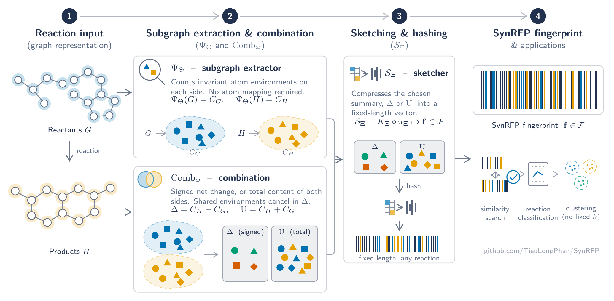

.. _getting_started:

===========================
Getting Started with SynRFP
===========================

Welcome to the **SynRFP** documentation!

**SynRFP** (Synthesis Reaction FingerPrint) is a generic, **mapping-free**, permutation-invariant framework for representing chemical transformations as fixed-length fingerprints :cite:`phan2025synrfp`.

Unlike traditional reaction representations that conflate structural extraction, reaction semantics, and compression, SynRFP explicitly separates featurization into three modular operators:

1. **Subgraph Extractor ($\Psi_\Theta$)**: Extracts discrete chemical motifs from reactant and product graphs as token multisets ($C_G$ and $C_H$).
2. **Algebraic Combiner ($\operatorname{Comb}_\omega$)**: Summarizes changes as signed net change ($\Delta = C_H - C_G$) and/or total motif abundance ($U = C_H + C_G$).
3. **Randomized Sketcher ($\mathcal{S}_\Xi$)**: Compresses token summaries into fixed-length binary or real-valued vectors $\mathbf{f} \in \mathcal{F}$.

.. _fig:synrfp-workflow:

   Figure 1 — The three-stage SynRFP pipeline: subgraph extraction ($\Psi$), algebraic combination ($\operatorname{Comb}_\omega$), and sketching ($\mathcal{S}$).

------------
Installation
------------

Python Requirements
~~~~~~~~~~~~~~~~~~~

SynRFP requires **Python 3.11 or later**.

Create an Isolated Environment (Recommended)
~~~~~~~~~~~~~~~~~~~~~~~~~~~~~~~~~~~~~~~~~~~~

.. code-block:: bash

   # Using venv
   python -m venv .venv
   source .venv/bin/activate

   # Or using Conda / Mamba
   conda create --name synrfp-env python=3.11
   conda activate synrfp-env

Install from PyPI
~~~~~~~~~~~~~~~~~

Install the latest release:

.. code-block:: bash

   # Core package
   pip install synrfp

   # With parallel batch encoding support (joblib)
   pip install "synrfp[parallel]"

Install from Source for Development
~~~~~~~~~~~~~~~~~~~~~~~~~~~~~~~~~~~

.. code-block:: bash

   git clone https://github.com/TieuLongPhan/SynRFP.git
   cd SynRFP
   pip install -e ".[dev,parallel]"

Run tests to verify installation:

.. code-block:: bash

   pytest

-------------------
Quick Sanity Checks
-------------------

Check the installed version:

.. code-block:: bash

   python -c "import synrfp; print(synrfp.__version__)"

----------------------------------
Core Concepts & The Three Stages
----------------------------------

1. **Extraction ($\Psi$)**:
   - :class:`~synrfp.tokenizers.wl.WLTokenizer`: 1D Weisfeiler–Lehman subtree refinement (*default*).
   - :class:`~synrfp.tokenizers.morgan.MorganTokenizer`: Circular atom environments of radius $0 \dots R$.
   - :class:`~synrfp.tokenizers.path.PathTokenizer`: Simple linear paths of bounded length.
   - :class:`~synrfp.tokenizers.nauty.NautyTokenizer`: Exact canonical certificate for ego-subgraphs.
   - :class:`~synrfp.tokenizers.map.MAPTokenizer`: MinHashed atom-pair features.

2. **Combination ($\operatorname{Comb}_\omega$)**:
   - ``mode="delta"`` ($\Delta = C_H - C_G$): Signed net change. Identifies created motifs ($\Delta > 0$) vs. consumed motifs ($\Delta < 0$), cancels spectator agents, and enforces directionality ($\Delta(H \to G) = -\Delta(G \to H)$).
   - ``mode="union"`` ($U = C_H + C_G$): Unsigned total motif abundance preserving overall chemical context.

3. **Sketching ($\mathcal{S}$)**:
   - :class:`~synrfp.sketchers.parity_fold.ParityFold`: Compact XOR parity folding into $B$ bits.
   - :class:`~synrfp.sketchers.minhash_sketch.MinHashSketch`: Minwise hashing estimating unweighted Jaccard similarity.
   - :class:`~synrfp.sketchers.cw_sketch.CWSketch`: Consistent Weighted Sampling estimating weighted Jaccard similarity while preserving motif counts.
   - :class:`~synrfp.sketchers.srp_sketch.SRPSketch`: Signed Random Projection estimating cosine similarity.

----------------
Minimal Examples
----------------

1. High-Level One-Liner
~~~~~~~~~~~~~~~~~~~~~~~

Compute a 1024-bit binary fingerprint with default parameters:

.. code-block:: python

   from synrfp import synrfp

   # Compute fingerprint directly from reaction SMILES
   bits = synrfp(
       "CCO>>C=C.O",
       tokenizer="wl",    # Weisfeiler-Lehman
       radius=2,          # 2 iterations / hops
       sketch="parity",   # ParityFold XOR sketch
       bits=1024,         # output bit length
       mode="delta",      # signed net change
       seed=42,
   )

   print(f"Fingerprint: {len(bits)} bits, {sum(bits)} active bits")
   print("First 16 bits:", bits[:16])

2. Programmatic Engine Composition
~~~~~~~~~~~~~~~~~~~~~~~~~~~~~~~~~~

Compose custom tokenizers and sketchers and inspect intermediate reaction representations:

.. code-block:: python

   from synrfp import SynRFP
   from synrfp.graph.reaction import Reaction
   from synrfp.tokenizers.wl import WLTokenizer
   from synrfp.sketchers.parity_fold import ParityFold

   # 1) Parse reaction SMILES
   rxn = Reaction.from_rsmi("CCO>>C=C.O")

   # 2) Compose tokenizer and sketcher
   tokenizer = WLTokenizer()
   sketcher = ParityFold(bits=1024, seed=42)
   engine = SynRFP(tokenizer=tokenizer, radius=2, sketch=sketcher)

   # 3) Generate fingerprint result
   result = engine.fingerprint(rxn.reactant, rxn.product, mode="delta")

   # 4) Inspect extracted information
   print("Reactant token count:", len(result.tokens_R))
   print("Product token count: ", len(result.tokens_P))
   print("Non-zero delta tokens:", len(result.delta))

   # 5) Retrieve bit representation
   bits = result.to_binary()

3. High-Throughput Batch Encoding
~~~~~~~~~~~~~~~~~~~~~~~~~~~~~~~~~

Encode multiple reactions with parallel CPU support:

.. code-block:: python

   from synrfp import BatchEncoder

   rxn_smiles = [
       "CCO>>C=C.O",
       "CC(=O)O.OCC>>CC(=O)OCC.O",
       "CO.O[C@@H]1CCNC1.[C-]#[N+]CC(=O)OC>>[C-]#[N+]CC(=O)N1CC[C@@H](O)C1",
   ]

   # Fast serial convenience call
   fps = BatchEncoder.encode(
       rxn_smiles,
       tokenizer="wl",
       radius=2,
       sketch="parity",
       bits=1024,
       mode="delta",
   )
   print("Output shape:", fps.shape)  # (3, 1024)

   # Parallel batch processing with memory chunking
   encoder = BatchEncoder(
       tokenizer="wl",
       radius=2,
       sketch="parity",
       bits=1024,
       n_jobs=4,
       batch_size=128,
   )
   fps_parallel = encoder.encode_many(rxn_smiles)

For more in-depth recipes, machine learning integration, and similarity metrics, visit
:doc:`Tutorials and Examples <tutorials_and_examples>`.